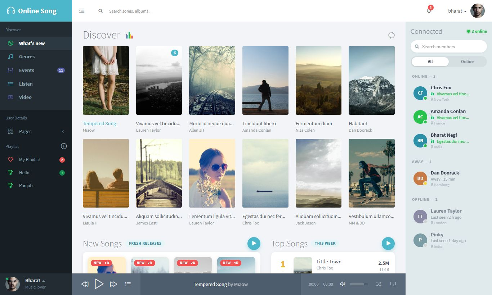
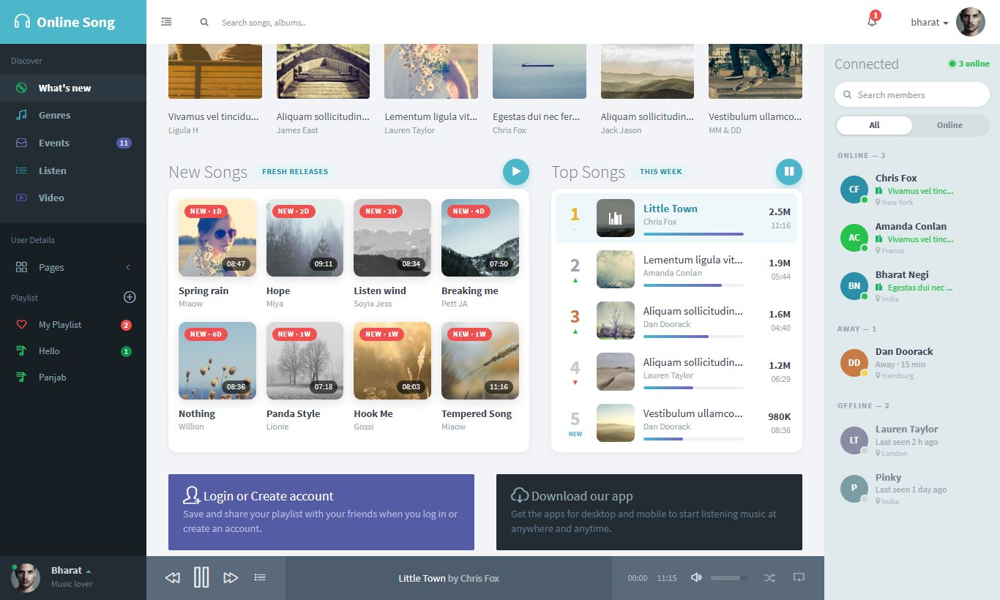
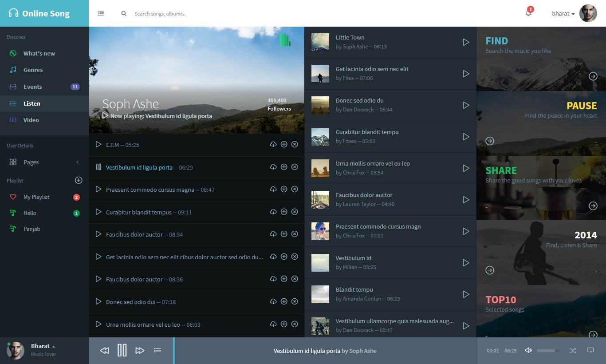
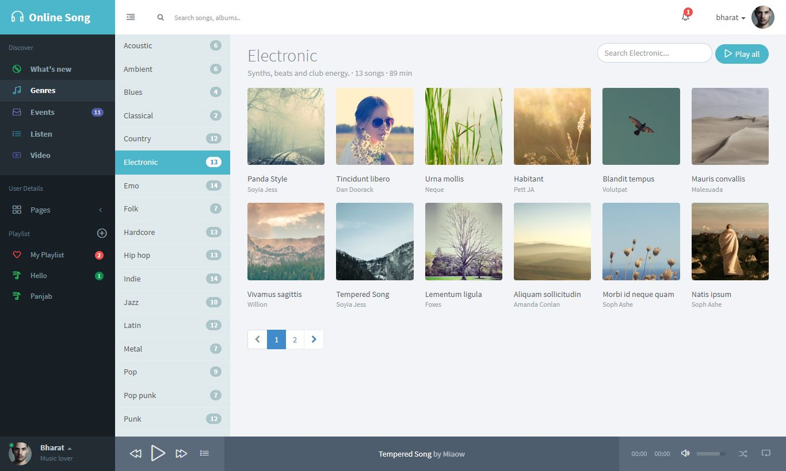
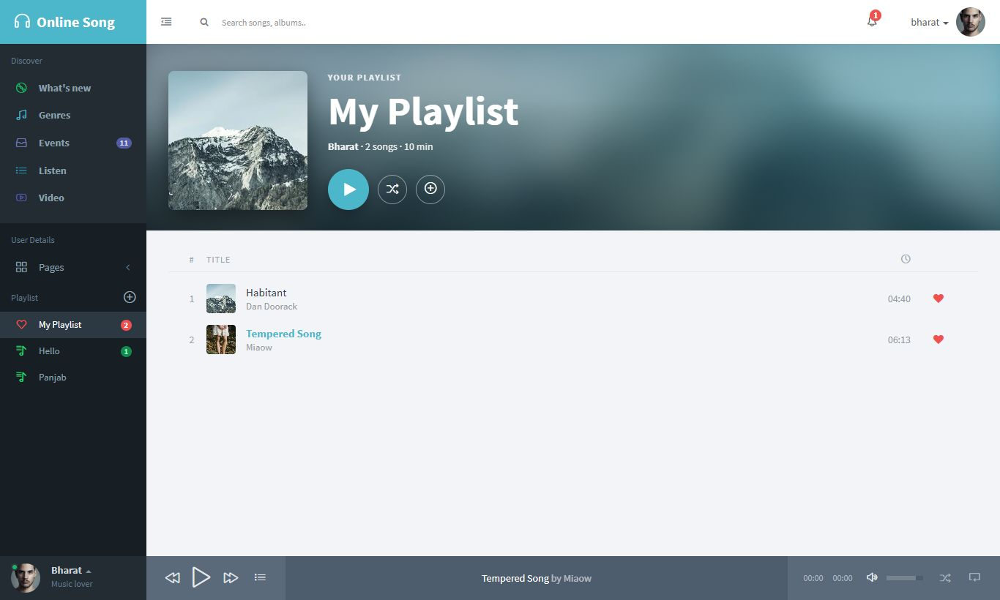
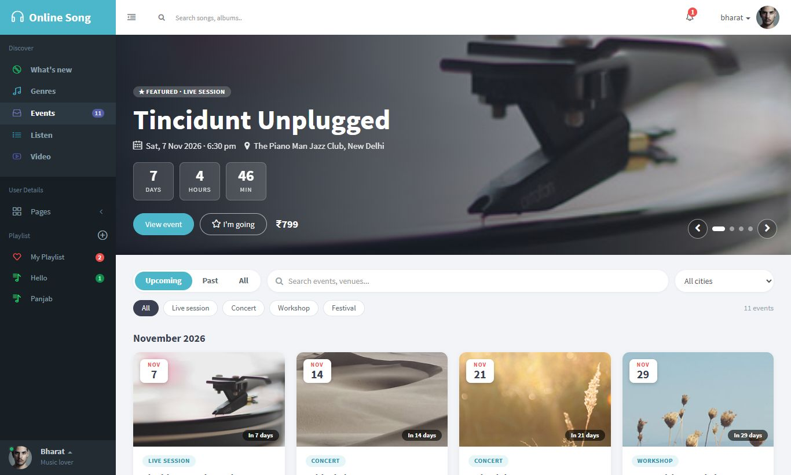
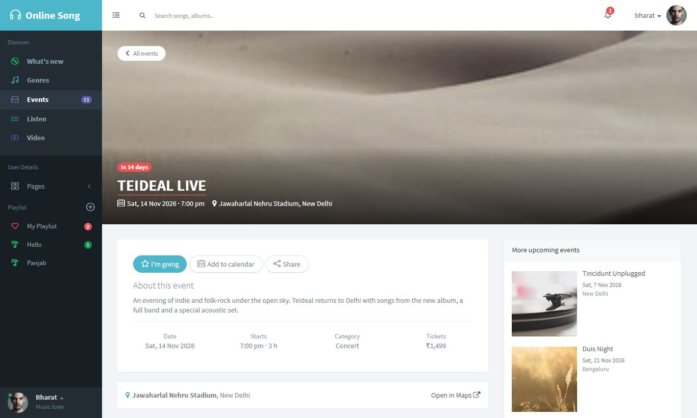
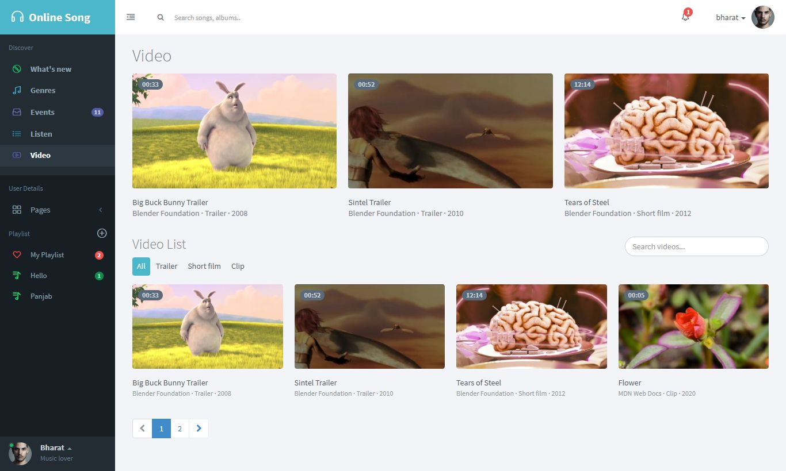
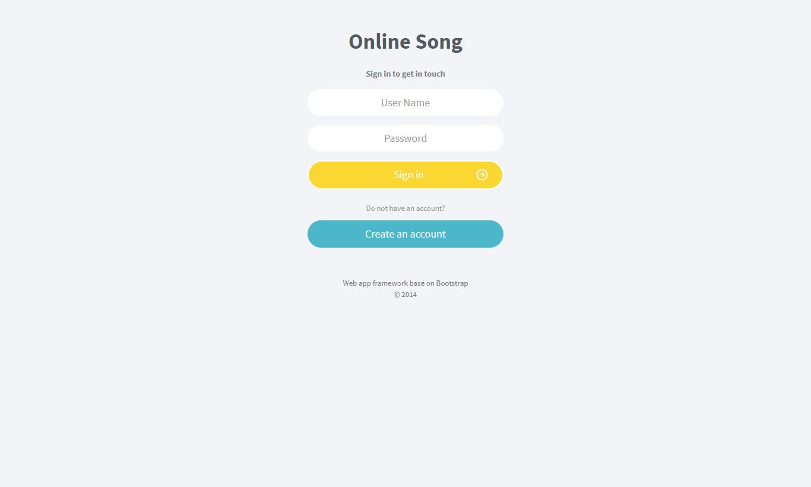

# Online Song

A music-streaming web app built with **React 18** and **Vite**. You can browse and play songs, build playlists, follow genres, watch videos, find live events and manage your own profile. A small **json-server** backend stores accounts, comments, notifications and each user's library.

> **Demo project.** Login, passwords and the API are not secure yet (see [Known limitations](#known-limitations)). Run it locally; do not deploy it as is.



---

## Contents

- [Features](#features)
- [Screenshots](#screenshots)
- [Tech stack](#tech-stack)
- [Getting started](#getting-started)
- [Available scripts](#available-scripts)
- [Project structure](#project-structure)
- [Data and API](#data-and-api)
- [Customising content](#customising-content)
- [Media credits](#media-credits)
- [Known limitations](#known-limitations)

---

## Features

### Accounts
- **Sign up and log in.** Pages that need a login send you to the login page first.
- **Profile photo:** upload your own picture (it's cropped and resized automatically), or use coloured initials.
- **Profile page:** city, bio and social links you can edit; counts of favourites, playlists and events; tabs for **Favourites, Playlists, Events and Comments**; and friends who are online.
- **Settings page:**
  - change your email or password
  - starting volume and autoplay
  - collapsed sidebar
  - download your data as JSON
  - clear favourites, reset your library or delete your account

### Music player
- **One player for the whole app,** so music keeps playing when you change page.
- **Controls:** play/pause, previous/next, seek bar, volume, mute, shuffle, repeat and a playlist pop-up.
- **The current list becomes the queue:** whatever list you start from (Discover, a genre, a playlist, the charts…).
- **Visual cues:** animated equaliser bars and live time badges show what's playing.

### What's new (home)
- **Discover:** song cards with play, a star rating, bookmark, ♥ favourite and an **add-to-playlist** menu. All of these are saved per user. Refresh shuffles the cards.
- **New Songs:** fresh releases with "NEW · 2d" badges and a progress line on the playing cover.
- **Top Songs:** a weekly chart with gold, silver and bronze ranks, ▲▼ trend arrows and popularity bars.
- **Connected:** friends grouped by Online, Away and Offline. You can see what they're listening to and **listen along**, and search the list.

### Genres
- **22 genres,** each on its own page (`/genres/rock`, `/genres/jazz`…).
- **On each genre page:** Play all, search within the genre, pagination, and the same card controls as Discover.

### Listen
- **An artist album and a recommendations list.** The banner picture and artist details change with the song that's playing.
- **Song actions:** download, add to queue, and remove from the list.

### Playlists
- **Built in:** "My Playlist", plus your own playlists created from the sidebar **⊕** or from any song's **+** menu.
- **Playlist page:**
  - a cover collage, Play all and Shuffle
  - rename and delete
  - an **Add songs** search across every song in the app

### Video
- **6 openly licensed videos** with filters, search and pagination.
- **Video pages** (`/video/:id`) with the player, details, suggestions, previous/next, and their own comments. Starting a video pauses the music.

### Events
- **Featured banner** with a live countdown. It follows the selected **city** and **category**.
- **Filters:** Upcoming, Past or All; category chips; a city menu; and search.
- **"Your upcoming events"** strip, and cards grouped by month.
- **Event pages** (`/events/:id`) with **I'm going** (saved per user), **Add to calendar** (downloads an `.ics` file), Share, and Open in Maps.

### Other
- **Notifications:** a bell with an unread count, "mark as read" and links to the related page.
- **Comments** on the Blog and every video.
- **Phone layout:** a slide-in menu on small screens.

---

## Screenshots

| | |
|---|---|
|  <br> New Songs and the Top Songs chart |  <br> Listen |
|  <br> Genre page |  <br> Playlist |
|  <br> Events |  <br> Event page |
|  <br> Video |  <br> Login |

---

## Tech stack

| Area | Used |
|---|---|
| UI | React 18, React Router 6 |
| Build / dev server | Vite 4 (`@vitejs/plugin-react-swc`), Sass |
| Styling | Bootstrap 3-based theme CSS (`src/css`, `src/scss/theme.scss`) plus custom styles in `src/scss/newtheme.scss` |
| Icons | Font Awesome 4.0, Simple Line Icons |
| Messages | react-toastify |
| Backend (mock REST API) | [json-server](https://github.com/typicode/json-server) 0.17 serving `db.json` |
| Linting | ESLint (react, react-hooks, react-refresh) |

---

## Getting started

### Requirements

- [Node.js](https://nodejs.org/) 18 or newer (tested with Node 24)
- npm
- An internet connection: the sample audio and video files are streamed from other websites (see [Media credits](#media-credits))

### 1. Get the code

```bash
git clone https://github.com/Bharat-Negi/online-song.git
cd online-song
npm install
```

### 2. Start the API (terminal 1)

```bash
npm run server
```

This starts json-server at **http://localhost:8000**, using `db.json`. Keep it running: login, comments, notifications, playlists, favourites and settings all need it.

### 3. Start the app (terminal 2)

```bash
npm run dev
```

Open **http://localhost:5173**, then click **Create an account** to sign up, or log in with one of the sample users in `db.json`.

> On some Windows machines Vite listens only on IPv6. If `127.0.0.1:5173` does not open, use `http://localhost:5173`.

---

## Available scripts

| Command | What it does |
|---|---|
| `npm run dev` | Starts the Vite dev server with hot reload (port 5173) |
| `npm run server` | Starts json-server on port 8000, watching `db.json` |
| `npm run build` | Builds the production files into `dist/` |
| `npm run preview` | Serves the built `dist/` folder locally |
| `npm run lint` | Runs ESLint on the project |

---

## Project structure

```
online-song/
├── db.json                     # json-server database (users, comments, notifications, library)
├── index.html
├── public/
│   ├── images/                 # covers, artists, avatars, video thumbnails (images/videos/)
│   └── fonts/
├── docs/screenshots/           # images used in this README
└── src/
    ├── App.jsx                 # routes, player and library providers
    ├── index.jsx               # entry point and global CSS
    ├── main.scss               # imports the theme and custom styles
    ├── pages/                  # one file per page
    │   ├── what-new.jsx        #   home (Discover, New Songs, Top Songs, Connected)
    │   ├── genres.jsx          #   genre list (left) + selected genre (right)
    │   ├── listen.jsx
    │   ├── my-playlist.jsx     #   "My Playlist" and custom playlists
    │   ├── video.jsx, video-detail.jsx
    │   ├── events.jsx, event-detail.jsx
    │   ├── profile.jsx, settings.jsx
    │   ├── login.jsx, signup.jsx
    │   ├── blog.jsx, invoice.jsx
    │   └── layout.jsx          #   header + sidebar wrapper, login check
    ├── genres-pages/genre.jsx  # one page for every genre (/genres/:genre)
    ├── common-pages/           # shared parts and logic
    │   ├── playerContext.jsx   #   the audio player for the whole app
    │   ├── libraryContext.jsx  #   per-user favourites, playlists, events, profile…
    │   ├── songCatalog.js      #   every song in one list (for playlists)
    │   ├── eventUtils.js       #   dates, countdown, calendar (.ics) export
    │   ├── avatar.jsx          #   photo or initials avatar
    │   ├── header.jsx, leftBar.jsx, connected.jsx, jsPlayer.jsx
    │   ├── commentSection.jsx, useComments.js, useNotifications.js
    │   └── uiSettings.js       #   appearance settings (this device)
    ├── component/discover.jsx
    ├── component-small/        # cards and small blocks (new songs, top songs, profile…)
    ├── json-data/              # static content (songs, genres, videos, events…)
    ├── css/                    # Bootstrap theme, icon fonts, player CSS
    └── scss/                   # theme.scss (template) and newtheme.scss (custom)
```

---

## Data and API

### json-server (`db.json`)

| Collection | Used for |
|---|---|
| `user` | Accounts: `id` (username), `password`, `email` |
| `notification` | Header bell: `text`, `image`, `link`, `time`, `read` |
| `comment` | Comments: `page` (`blog` or `video-<id>`), `name`, `email`, `text`, `image`, `time` |
| `library` | One record per user (`id` = username): `favourites`, `bookmarks`, `playlist`, `playlists`, `events`, `ratings`, `avatar`, `profile` |

The app calls `http://localhost:8000` directly. To change the address, search the `src` folder for `localhost:8000`.

### Static content (`src/json-data`)

| File | Content |
|---|---|
| `discover.json` | Discover cards (also the default play queue) |
| `new-song.json`, `top-song.json` | Home page New Songs and the Top Songs chart (plays, trend) |
| `genres.json` | 22 genres and their songs |
| `listen.json` | Listen page album, recommendations and artist details |
| `videos.json` | Videos, sources and descriptions |
| `events.json` | Events: date, venue, city, price, category, featured |
| `connected.json` | Friends in the Connected panel and what they're listening to |

### Saved in the browser (per device)

- `player-settings`: starting volume and autoplay
- `ui-settings`: collapsed sidebar

---

## Customising content

- **Add a song to a genre:** add an entry to that genre's `songs` in `src/json-data/genres.json` (`id`, `name`, `artist`, `image`, `src`, `time`). It appears on the genre page, in search and in the playlist "Add songs" search.
- **Add a genre:** add a new object to `genres.json` with a unique `slug`. The sidebar link and page are created automatically.
- **Add an event or video:** add an entry to `events.json` or `videos.json` with the same fields as the others. Filters, counts and banners update automatically.
- **Use your own music:** put MP3 files in `public/audio/` and point a song's `src`/`disAudio`/`newAudio`/`topAudio` to `/audio/your-file.mp3`.
- **Add a notification:** add an entry to `notification` in `db.json` while json-server is running.

---

## Media credits

- **Music:** sample tracks by T. Schürger from [SoundHelix](https://www.soundhelix.com/) (`SoundHelix-Song-1…17.mp3`), streamed from soundhelix.com. Song titles and artist names in the app are placeholders and don't match the audio.
- **Videos:**
  - *Big Buck Bunny*, *Sintel* and *Tears of Steel* © Blender Foundation, [CC BY](https://creativecommons.org/licenses/by/3.0/), streamed from download.blender.org and Wikimedia Commons.
  - *Flower* from [MDN Web Docs](https://developer.mozilla.org/) (CC0).
- **Images and layout:** based on a Bootstrap 3 music web-app template. Pictures in `public/images` come with that template. Video thumbnails are frames from the videos above.
- **Demo content:** event names, prices, follower counts, chart numbers and friends are made up.

---

## Known limitations

This is a learning/demo project. Before putting it online:

- **Authentication is not secure.**
  - Passwords are stored in plain text in `db.json`, and the login page compares them in the browser.
  - "Logged in" is only a username in `sessionStorage`.
- **The API is open.** json-server lets anyone read or change any data, and allows requests from any website. Use a real backend (for example `json-server-auth` or an Express server with hashed passwords and tokens) before deploying.
- **`db.json` is in the repository,** including the sample accounts. Don't use real passwords for them.
- **Dependencies:** `npm audit` reports known issues, mostly from the unused `react-scripts` package, which can be removed.
- **External media:** the music and videos are streamed from other websites, so they need an internet connection and may become unavailable.
- **Some template pages are static:** Blog posts and Invoice.
- **No licence file** has been added yet.
